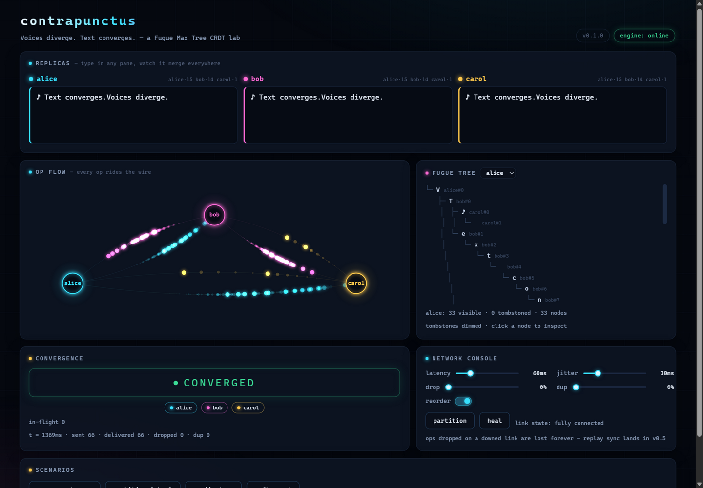

# contrapunctus

A Fugue Max Tree CRDT text engine with an interactive three-replica browser lab.
Edit concurrently, change message latency, duplicate or reorder operations, and inspect the tree as replicas merge.

**[Live lab →](https://qiyuhuating.github.io/contrapunctus/)** · [Architecture](ARCHITECTURE.md) · [Roadmap](ROADMAP.md)

TypeScript · ESM · Zero runtime dependencies



## Features

- **Fugue Max Tree:** tree-based ordering keeps concurrent insertion runs contiguous.
- **Out-of-order delivery:** operations with missing parents are buffered and retried.
- **Seeded network simulator:** virtual clock, latency, jitter, drops, duplication, reordering and partitions.
- **Grapheme edits:** `Intl.Segmenter` handles emoji sequences, combining accents and CJK.

Based on Weidner and Kleppmann's [The Art of the Fugue](https://arxiv.org/abs/2305.00583).

## Run locally

Node.js **20+**.

```sh
git clone https://github.com/qiyuhuating/contrapunctus.git
cd contrapunctus
npm ci
npm run demo
```

Open http://127.0.0.1:5179 . Type in any replica, adjust the network controls, or select a scenario.
Click a tree node to inspect its parent, side and causal dot.

The convergence meter stays `SYNCING` while operations are in flight or buffered.
Dropped operations are not retransmitted, so a partition can leave replicas out of sync.

## Test

```sh
npm test
npm run fuzz
npm run typecheck
npm run bench
```

Tests cover shuffled delivery, concurrent insertion runs, Unicode, operation counts and seeded network schedules.
Use `SEED=<n> npm run fuzz` to reproduce a fuzz seed.

## Layout

```text
src/crdt/    Fugue Max Tree replicas
src/net/     Virtual network and replica wiring
demo/        Browser lab
tests/       Fuzz suites
bench/       Benchmarks
```

## Limits

No anti-entropy or replay sync: dropped messages remain lost. Cursors are not anchored,
tombstones are retained indefinitely, and concurrent-delete intent follows the engine's convention.

[Design](DESIGN.md) · [Contributing](CONTRIBUTING.md) · [MIT](LICENSE)
